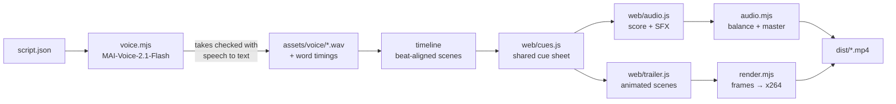

# 🎬 LazyVim for Windows — Trailer

A ~67-second, energetic trailer for this project, plus the fully reproducible pipeline that makes it.

- **Video:** [`dist/LazyVim-for-Windows-trailer.mp4`](dist/LazyVim-for-Windows-trailer.mp4) (1920×1080, 60 fps, H.264 + AAC)
- **Poster frame:** [`dist/poster.png`](dist/poster.png)

Everything in it is generated: the narration comes from **MAI-Voice-2.1-Flash** on Azure Speech, the music and sound effects are synthesized from code, and every frame is rendered in a headless browser. No stock footage, samples, or third-party music are used.

## 🧩 How it works



1. **Narration** — `scripts/voice.mjs` sends each line of `script.json` to Azure Speech using the `en-US-Ethan:MAI-Voice-2.1-Flash` voice with per-line emotion styles (confused, disgusted, sad, excited, joyful, relieved). Every take is transcribed with Azure fast transcription, and takes with missing, extra, or stuttered words are re-recorded automatically. Long pauses are tightened, and the word timestamps are kept so visuals can land on specific words.
2. **Timeline** — `scripts/lib/timeline.mjs` lays the lines out scene by scene on a 124 BPM grid. The two musical drops are anchored to words, so the beat hits exactly on “**Lazy**Vim” and “**Boom!**”.
3. **Cue sheet** — `web/cues.js` turns the timeline into the moments everything else keys off (tool chips popping as they are named, sound effects, the music arrangement). Visuals and audio share it, so they cannot drift apart.
4. **Music and sound** — `web/audio.js` composes an original electro-pop score (I–V–vi–IV in D major) and all sound effects with the Web Audio API in an `OfflineAudioContext`. The music is automatically ducked and EQ-carved under the voice. `scripts/audio.mjs` measures the stems (ITU-R BS.1770) so the bed sits roughly 10–16 dB under the narrator, then masters the mix to -14 LUFS with a -1.5 dBTP ceiling.
5. **Visuals** — `web/trailer.html` and `web/trailer.js` draw every frame as a pure function of time. `scripts/render.mjs` screenshots frames in parallel headless Edge workers and encodes them with x264.

## 🛠️ Rebuilding

Requirements: Windows with Microsoft Edge, Node.js 20+, and (only to re-record narration) the Azure CLI.

```powershell
cd trailer
npm install
npm run build            # full 1080p60 render → dist/
npm run build:preview    # quick 540p30 render → build/
```

The recorded narration is checked in under `assets/voice/`, so rebuilding the video or tweaking visuals and music does **not** need Azure.

### Re-recording the narration

Edit `script.json`, then run:

```powershell
az login
npm run voice                       # only re-records lines whose text or style changed
npm run voice -- --only=cta --force # re-record one line
```

The script finds credentials in this order:

1. `SPEECH_KEY` and `SPEECH_REGION`
2. `SPEECH_RESOURCE` and `SPEECH_RESOURCE_GROUP` (key fetched with the Azure CLI)
3. A Speech resource tagged `purpose=lazyvim-trailer` in the current subscription

Line options in `script.json`: `style` (an `mstts:express-as` style), `rate` (SSML prosody, for example `+8%`), `takes` (record several clean takes and keep the snappiest), and `maxPause`/`keepPause` (pause tightening).

### Other handy commands

```powershell
npm run stills -- 12.4 49.2   # render specific moments (seconds) to build/stills/
npm run preview               # live in-browser preview with sound (after a build)
npm run qa                    # transcribe the finished mix and report loudness
```

## 📄 Credits

- Voice: MAI-Voice-2.1-Flash (`en-US-Ethan`) via Azure Speech.
- The LAZYVIM block wordmark and dashboard recreation pay homage to [LazyVim](https://github.com/LazyVim/LazyVim) and its Tokyo Night look.
- Music, sound effects, and visuals are original and generated by the code in this folder.
