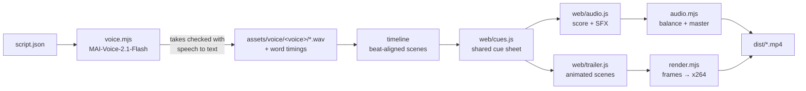

# 🎬 LazyVim for Windows — Trailer

A ~70-second trailer for this project: upbeat and fun, but with the narration always in front. It comes in two narrations, built by the same reproducible pipeline:

| Narrator | Video |
| --- | --- |
| 🇺🇸 American (`en-US-Ethan`) | [`dist/LazyVim-for-Windows-trailer.mp4`](dist/LazyVim-for-Windows-trailer.mp4) |
| 🇬🇧 British (`en-GB-Harry`) | [`dist/LazyVim-for-Windows-trailer-british.mp4`](dist/LazyVim-for-Windows-trailer-british.mp4) |

Both are 1920×1080, 60 fps, H.264 + AAC. Poster frame: [`dist/poster.png`](dist/poster.png).

Everything in it is generated: the narration comes from **MAI-Voice-2.1-Flash** on Azure Speech, the music and sound effects are synthesized from code, and every frame is rendered in a headless browser. No stock footage, samples, or third-party music are used.

## 🧩 How it works



1. **Narration** — `scripts/voice.mjs` sends each line of `script.json` to Azure Speech with the chosen narrator (`en-US-Ethan` or `en-GB-Harry`, both `MAI-Voice-2.1-Flash`) and per-line emotion styles (confused, disgusted, sad, joyful, happy, relieved, narrator). Every take is transcribed with Azure fast transcription in the narrator's locale, and takes with missing, extra, or stuttered words are re-recorded automatically. Each line is recorded four times and the take closest to the delivery target is kept: a bright but unhurried pitch (for example 125–160 Hz median for Ethan, 115–150 Hz for Harry, so lines sound lively without tipping into a sales pitch) that keeps moving (a pitch spread of about 3.5–6 semitones, so nothing sounds monotone). Long pauses are tightened, and the word timestamps are kept so visuals can land on specific words.
2. **Timeline** — `scripts/lib/timeline.mjs` lays the lines out scene by scene on a 112 BPM grid. Musical entrances are anchored to words: the band lands on “**Lazy**Vim”, and the groove returns on “And **there** it is” as the dashboard appears.
3. **Cue sheet** — `web/cues.js` turns the timeline into the moments everything else keys off (tool chips appearing as they are named, sound effects, the music arrangement). Visuals and audio share it, so they cannot drift apart.
4. **Music and sound** — `web/audio.js` composes an original electric-piano groove (I–vi–IV–V in D major with sevenths) and all sound effects with the Web Audio API in an `OfflineAudioContext`. The arrangement follows the story: a wry pizzicato intro that tape-stops as the weekend disappears, a riser into a soft crash on the name, a clap-and-hats groove with pushed keys and a bouncing bass, an arpeggio and bells for the feature tour (the bells only play in the narrator's pauses), a lighter breakdown for “Relax”, and a snare-roll build with a breath of silence before the reveal. The music is ducked and EQ-carved under the voice. `scripts/audio.mjs` measures the stems (ITU-R BS.1770) so the bed sits roughly 12–16 dB under the narrator, then masters the mix to -14 LUFS with a -1.5 dBTP ceiling.
5. **Visuals** — `web/trailer.html` and `web/trailer.js` draw every frame as a pure function of time. One `energy` setting in `script.json` (0 = calm, 1 = full-on; the trailer uses 0.5) scales how far and fast scenes slide, how much entrances overshoot, how strongly things pulse with the beat, and the size of the ring, sparks, flash, and camera nudge on the three big landings. `scripts/render.mjs` screenshots frames in parallel headless Edge workers and encodes them with x264.

## 🛠️ Rebuilding

Requirements: Windows with Microsoft Edge, Node.js 20+, and (only to re-record narration) the Azure CLI.

```powershell
cd trailer
npm install
npm run build                       # American narration, full 1080p60 → dist/
npm run build -- --voice=british    # British narration → dist/LazyVim-for-Windows-trailer-british.mp4
npm run build:preview               # quick 540p30 render → build/<voice>/
```

The recorded narration is checked in under `assets/voice/<voice>/`, so rebuilding the video or tweaking visuals and music does **not** need Azure.

### Re-recording the narration

Edit `script.json`, then run:

```powershell
az login
npm run voice                                   # American narration; only re-records lines that changed
npm run voice -- --voice=british                # British narration
npm run voice -- --voice=british --only=cta --force   # re-record one line
```

The script finds credentials in this order:

1. `SPEECH_KEY` and `SPEECH_REGION`
2. `SPEECH_RESOURCE` and `SPEECH_RESOURCE_GROUP` (key fetched with the Azure CLI)
3. A Speech resource tagged `purpose=lazyvim-trailer` in the current subscription

`script.json` has the shared `lines` (the words) and one entry per narrator under `voices` (the first is the default). A narrator sets `name`, `model`, `locale`, `takes`, and a default `delivery` target, and can override any line under `lines` with `style` (an `mstts:express-as` style the voice supports), `rate` (SSML prosody, for example `+5%`), `takes`, and `delivery` (`pitchHz` and `pitchSd` bands used to pick the take). Lines can also set `maxPause`/`keepPause` (pause tightening). Each line's measured pitch and speaking rate are saved in `assets/voice/<voice>/manifest.json`.

To add another narrator, add an entry under `voices` (for example `"emily": { "name": "en-GB-Emily", ... }`), then run `npm run voice -- --voice=emily` and `npm run build -- --voice=emily`.

### Other handy commands

```powershell
npm run stills -- 12.4 49.2 --voice=british   # render specific moments (seconds) to build/<voice>/stills/
npm run preview                               # live in-browser preview with sound (after a build)
npm run qa -- --voice=british                 # transcribe the finished mix and report loudness
```

## 📄 Credits

- Voices: MAI-Voice-2.1-Flash (`en-US-Ethan` and `en-GB-Harry`) via Azure Speech.
- The LAZYVIM block wordmark and dashboard recreation pay homage to [LazyVim](https://github.com/LazyVim/LazyVim) and its Tokyo Night look.
- Music, sound effects, and visuals are original and generated by the code in this folder.
